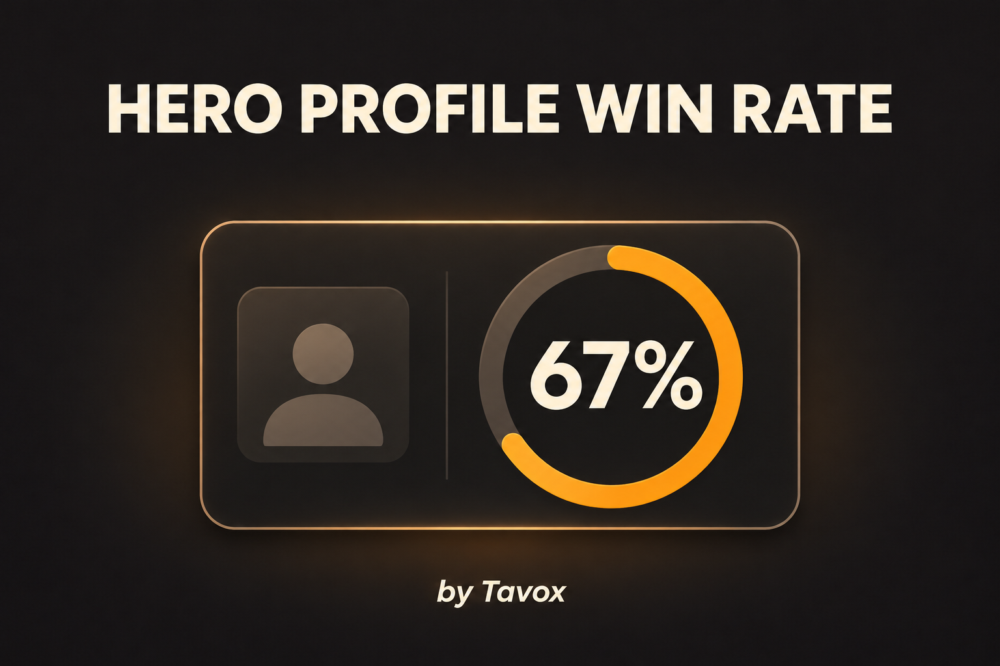

# Hero Profile Win Rate



A simple Deadlock mod by **Tavox**. Adds **Win Rate** beside **Commends** on the profile screen for All Heroes and each selected hero.

[Download the latest release](https://github.com/Taqiam/Deadlock-winrate-mod/releases/latest)

## Install

1. Close Deadlock.
2. In Deadlock Mod Manager, open **Mods Library → Add mods → Add Local Mod** and select the release ZIP.
3. Enable **Hero Profile Win Rate** in your active profile.
4. If another mod changes the profile layout, give this mod priority before it in **Change Mods Order**.
5. Re-apply mods, launch the game, and open your profile. Look beside Commends.

Disable the mod and re-apply to uninstall.

The percentage is wins / games played, displayed to one decimal place. Zero games or unavailable records show N/A. Uses existing profile statistics and requires no other mods or external API.

## Compatibility

Replaces `panorama/layout/citadel_db_page_profile.vxml_c`. Other mods that replace this layout cannot merge automatically; their profile additions may be hidden. Tested on Deadlock build **26390257**. Game updates may require rebuilding.

The cover is promotional artwork, not a gameplay screenshot.

## Read and build

Start with [profile_win_rate.js](profile_win_rate.js) and the [learning guide](LEARN.md). Build tools: Node.js and the official [Source 2 Viewer CLI](https://github.com/ValveResourceFormat/ValveResourceFormat/releases).

```powershell
node build.mjs "C:\Tools\Source2Viewer-CLI.exe" "D:\SteamLibrary\steamapps\common\Deadlock\game\citadel\pak01_dir.vpk"
```

Produces `win-rate_dir.vpk` with two resources. See [manual installation](MANUAL-INSTALL.md) if you do not use the manager.

## Credits

Tavox — mod author; developed with AI-assisted coding in Codex. Cover generated with AI.

Valve — Deadlock and the base profile UI. Source 2 Viewer / ValveResourceFormat contributors — asset inspection and format references.